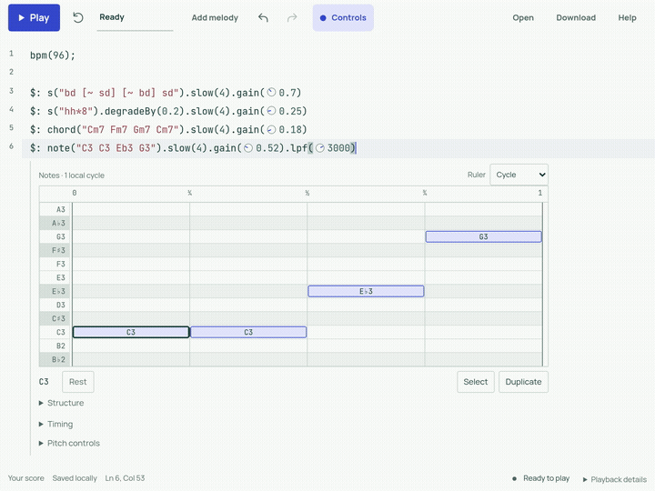

# moondsp

A text-first music editor in the browser. The source document is the score; visual controls operate on that text, and audio plays without interruption.

[Launch in browser](https://moondsp.koji-ishimoto.workers.dev/) · [Engine architecture](docs/engine-architecture.md)

---



<video src="docs/assets/demo.mp4" controls width="100%">
  <a href="docs/assets/demo.mp4">▶ Play demo with audio (MP4)</a>
</video>
<p><em>Turn on audio to hear the live groove and seamless loop transition. (<a href="docs/assets/demo.mp4">Direct video link</a>)</em></p>

---

## Principles

- **One score, text as truth**: Visual controls and code edit the exact same document. There are no hidden parameters, proprietary project files, or separate sequencer states. Every visual action writes standard text.
- **The editor is the instrument**: Controls unfold directly beneath the phrase at your cursor. You shape sound where your eyes and code already are, without switching between windows or inspector panels.

---

## Quick start

### In the browser

Open **[moondsp.koji-ishimoto.workers.dev](https://moondsp.koji-ishimoto.workers.dev/)** and press `Ctrl/⌘ + Enter` to play.

| Shortcut | Action |
|:---|:---|
| `Ctrl / ⌘ + Enter` | Play / Pause |
| `Ctrl / ⌘ + Shift + Enter` | Restart from beginning |
| `Ctrl / ⌘ + Z` | Undo (shared across code and visual edits) |
| `Ctrl / ⌘ + Shift + Z` | Redo |
| `Escape` | Return focus to code |

### From source

```bash
NEW_MOON_MOD=0 moon build browser --target wasm-gc --release
./playwright-sync-wasm.sh
npm --prefix web/live ci
npm --prefix web/live run dev
# Open http://localhost:5173/
```

---

## Technical documentation

The audio engine is written in [MoonBit](https://www.moonbitlang.com/), featuring compiled DSP graphs, rational-time pattern scheduling, and multi-target compilation (Web AudioWorklet and native CLAP).

- **[Engine Architecture & Details](docs/engine-architecture.md)** — Core design, package map, audio-thread contracts, and development workflows.
- **[Technical Reference](docs/technical-reference.md)** — DSP node definitions and runtime control surface.
- **[Mini-Notation Guide](docs/mini-notation.md)** — Pattern grammar, grouping, and method chaining.
- **[Live Coding Cookbook](docs/guides/live-coding-cookbook.md)** — Practical recipes and arranging techniques.
- **[Browser API Contract](docs/browser-api-contract.md)** — AudioWorklet lifecycle and JS/TS bindings.
- **[CLAP Plugin Guide](docs/clap-plugin-guide.md)** — Native plugin architecture and C ABI.
- **[Documentation Index](docs/README.md)** — Index of all design records and references.

---

## Shout-outs & Prior art

`moondsp` is shaped by the ideas of these projects and their creators:

- **[Strudel](https://strudel.cc/)** & **[TidalCycles](https://tidalcycles.org/)** (Alex McLean, Felix Roos) — Cyclic pattern algebra, mini-notation syntax, and frictionless browser live coding.
- **[kabelsalat](https://codeberg.org/froos/kabelsalat)** (Felix Roos) — Zero-overhead DSP graph compilation inside Web AudioWorklet.
- **[Noisecraft](https://noisecraft.app/)** (Maxime Chevalier-Boisvert) — In-browser visual synthesis and topological graph execution.
- **[Sonic Pi](https://sonic-pi.net/)** (Sam Aaron) — Live coding as performance, and making musical programming welcoming and expressive.
- **[FAUST](https://faust.grame.fr/)** & **[mimium](https://mimium.org/)** (GRAME, Tomoya Matsuura) — Functional stream processing and algebraic signal graphs.

---

## License

[Apache-2.0](LICENSE)
