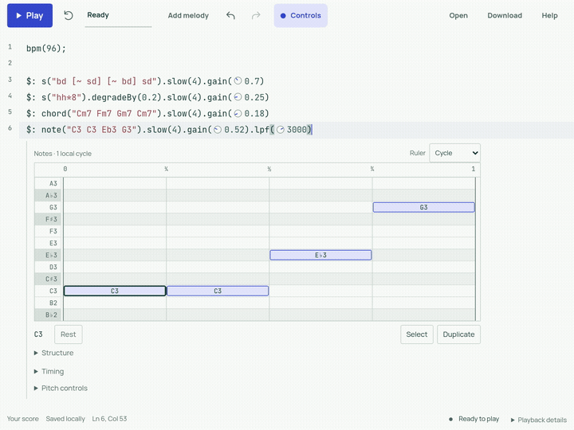

# moondsp

A text-first music editor in the browser. The source document is the score; visual controls operate on that text, and audio plays without interruption.

[Launch in browser](https://moondsp.koji-ishimoto.workers.dev/) · [Engine architecture](docs/engine-architecture.md)

---




<video src="https://github.com/user-attachments/assets/d5f6e781-3512-448d-a395-f3e8c04a79da" controls width="100%"></video>

---

## Principles

- **One score, text as truth**: Visual controls and code edit the exact same document. There are no hidden parameters, proprietary project files, or separate sequencer states. Every visual action writes standard text.
- **The editor is the instrument**: Controls unfold directly beneath the phrase at your cursor. You shape sound where your eyes and code already are, without switching between windows or inspector panels.

---

## Quick start

### In the browser

Open **[Playground](https://moondsp.koji-ishimoto.workers.dev/)** and press `Ctrl/⌘ + Enter` to play.

| Shortcut | Action |
|:---|:---|
| `Ctrl / ⌘ + Enter` | Play / Pause |
| `Ctrl / ⌘ + Shift + Enter` | Restart from beginning |
| `Ctrl / ⌘ + Z` | Undo (shared across code and visual edits) |
| `Ctrl / ⌘ + Shift + Z` | Redo |
| `Escape` | Return focus to code |

### From source

```bash
NEW_MOON_MOD=0 moon build browser --target wasm-gc --release
./playwright-sync-wasm.sh
npm --prefix web/live ci
npm --prefix web/live run dev
# Open http://localhost:5173/
```

---

## Technical documentation

The audio engine is written in [MoonBit](https://www.moonbitlang.com/), featuring compiled DSP graphs, rational-time pattern scheduling, and multi-target compilation (Web AudioWorklet and native CLAP).

### Use moondsp as a library

| Goal | Recommended entry point | Start here |
|---|---|---|
| Build a browser instrument with one Power on/off control | `AudioPower` from `@moondsp/browser/audio` owns the context and engine | [Browser package guide](packages/browser/README.md#choose-an-api) |
| Use an existing AudioContext or custom output routing | `GraphEngine` from `@moondsp/browser`; your app owns the context | [Caller-owned context example](packages/browser/README.md#2-caller-owned-context-example) |
| Render audio in a MoonBit host | `GraphEngine` and a reusable `AudioBuffer` | [Checked MoonBit examples](engine/README.mbt.md#mount-and-play-a-graph) |
| Decode/encode WAV and FLAC files in MoonBit | `@codec.decode_any`, `@wav`, `@flac` | [Audio codec guide](docs/audio-codec.md) |
| Render a Mini pattern offline to a `.wav` file | `@render.render_wav` and the render-to-file CLI | [Audio codec guide](docs/audio-codec.md) and [CLI example](examples/render-to-file/README.md) |
| Build a complete keyboard synth | Shared instrument core with vanilla TypeScript or Svelte UI | [Basic synth example](examples/basic-synth/README.md) |
| Write patterns and arrangements in the editor | Mini notation | [Live coding cookbook](docs/guides/live-coding-cookbook.md) |

For browser authoring, use `Graph()` to connect node references without
indices, and `update()` for atomic named parameter and gate changes. Mount all graphs
before the first `play()`. The browser graph API is mono and does not provide
timestamped automation or polyphonic note allocation. Its package is available
as a [locally built tarball](packages/browser/README.md#1-installation), not a
documented npm-registry release. CLAP remains a prototype, not DAW-ready.

- **[Engine Architecture & Details](docs/engine-architecture.md)** — Core design, package map, audio-thread contracts, and development workflows.
- **[Technical Reference](docs/technical-reference.md)** — DSP node definitions and runtime control surface.
- **[Mini-Notation Guide](docs/mini-notation.md)** — Pattern grammar, grouping, and method chaining.
- **[Audio Codec Guide](docs/audio-codec.md)** — WAV read/write, FLAC decode, unified decoding, and offline `.wav` rendering.
- **[Live Coding Cookbook](docs/guides/live-coding-cookbook.md)** — Practical recipes and arranging techniques.
- **[Browser API Contract](docs/browser-api-contract.md)** — AudioWorklet lifecycle and JS/TS bindings.
- **[CLAP Plugin Guide](docs/clap-plugin-guide.md)** — Native plugin architecture and C ABI.
- **[Documentation Index](docs/README.md)** — Index of all design records and references.

---

## Shout-outs & Prior art

`moondsp` is shaped by the ideas of these projects and their creators:

- **[Strudel](https://strudel.cc/)** & **[TidalCycles](https://tidalcycles.org/)** (Alex McLean, Felix Roos) — Cyclic pattern algebra, mini-notation syntax, and frictionless browser live coding.
- **[kabelsalat](https://codeberg.org/froos/kabelsalat)** (Felix Roos) — Zero-overhead DSP graph compilation inside Web AudioWorklet.
- **[Noisecraft](https://noisecraft.app/)** (Maxime Chevalier-Boisvert) — In-browser visual synthesis and topological graph execution.
- **[Sonic Pi](https://sonic-pi.net/)** (Sam Aaron) — Live coding as performance, and making musical programming welcoming and expressive.
- **[FAUST](https://faust.grame.fr/)** & **[mimium](https://mimium.org/)** (GRAME, Tomoya Matsuura) — Functional stream processing and algebraic signal graphs.

---

## License

[Apache-2.0](LICENSE)
